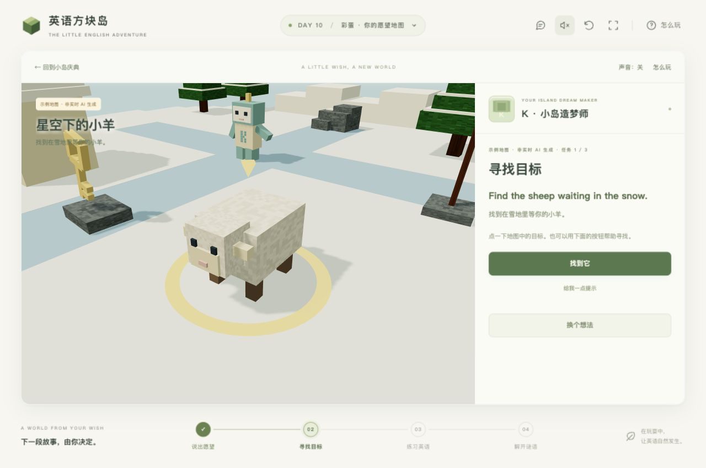

# 第十关彩蛋：K 的愿望地图

第十关庆典完成后，新朋友 K 带着一颗小星星出现。通关卡提供「和 K 聊聊」入口，继续探索时也可以点击 K。已完成第十关的玩家可以从关卡菜单再次找到 K。

玩家用中文或英文描述一个愿望，例如「我想去星空下的海边，帮助一只迷路的小羊」。K 回应并给出地图预览；玩家可以继续说「换成雪地」来修改，然后选择「就玩这个」。每张地图有三个挑战：寻找目标、输入英语词、回答一个小谜语。英语任务会鼓励玩家先读出声，但这一版不会识别或评分麦克风语音。

## 哪些内容真的会变化

AI 返回结构化的故事与地图方案，游戏把它画成可交互的方块世界。首版支持森林、海边、雪地、星夜、农场五种主题，晴朗、下雨、星空三种天气，以及树、花、小羊、船、房子、桥、灯塔、蛋糕、旗帜、石头、钥匙、宝箱等物件。地图的布局由种子确定，任务目标对应真实可点选的物件。

生成方案只能使用支持的元素和任务。它不是任意代码、外部模型下载或无边界的游戏编辑器。玩家的修改意见会连同前一张方案发送给模型，模型在这些可玩的元素中调整下一次冒险。

## 模型连接与示例试玩

完整网站提供 `GET /api/wish` 查询可用状态，`POST /api/wish` 生成或修改方案。服务器使用 OpenAI Responses API 和严格的结构化输出；默认模型为 `gpt-4o-mini`，可通过 `OPENAI_MODEL` 调整为支持相同输出格式的模型。

需要的服务器配置：

| 名称 | 用途 |
| --- | --- |
| `OPENAI_API_KEY` | 服务器调用模型的密钥，不进入浏览器、日志或 Git |
| `OPENAI_MODEL` | 可选的模型名称 |

本地开发可复制 `.dev.vars.example` 为被 Git 忽略的 `.dev.vars`，通过安全的凭据配置流程写入密钥。Sites 部署时通过运行环境的秘密配置管理，不把值加入源码或托管清单。OpenAI Developers 插件用于安全配置；不要在公开 Issue 或聊天中粘贴密钥。

**没有配置模型时，服务器返回明确的不可用状态。** 玩家可以选择「先试玩一张示例地图」，并始终看到示例标识。这些方案来自 `public/game/wish-examples.json`，不是临时关键词拼接，也不声称是实时 AI 输出。纯静态服务器只支持这类示例试玩；实时生成要运行完整网站。

当前开发记录：真实模型服务尚未接通，因此模型生成效果与实际费用尚未实测。接口实现和模拟网络的自动测试不能替代真实模型联调；接通后需用至少三个不同愿望与一次修改请求验证。

## 对话、语音与保存

一次愿望最多 280 个字符，携带有限的近期对话和上一张经过验证的地图。玩家可以调整方案后再开始；服务失败时保留输入和已可玩的地图。聊天只用于当前会话，不写入游戏数据库或公开仓库。请求设置 `store: false`；这不等于替模型提供商作零保留承诺。

动态对话与谜语先显示双语字幕。词汇点读只复用已有 JJ 本地录音，不能因为动态文本没有录音就自动换成系统声线。原有 200 段音频保持不变。

## 开发与验证

- `public/game/js/wish-contract.js`：共享方案约束、固定物件词汇与验证。
- `lib/wish-ai.ts`、`lib/wish-runtime.ts`、`app/api/wish/route.ts`：只在服务器调用模型与读取配置。
- `public/game/js/wish-world.js`：真实地图、点击对象和镜头。
- `public/game/js/world-wish.js`：对话、预览、输入任务、提示与暂停。
- `public/game/wish.html`、`wish.css`：彩蛋界面。

模型输出必须再次验证，文本以文本节点展示。响应中的链接或代码不会执行。任务必须引用存在的对象，英语答案与目标词对应；否则整份方案拒绝使用。错误不会暴露上游响应或密钥。接口有输入大小、超时、同源和请求频率限制；内存频率计数不等同跨所有服务器实例的统一额度，上线前还需结合提供商预算设置和实际访问量验收。

运行 `npm run typecheck`、`npm test`、`npm run build`，再分别验证无服务的示例流程与配置服务后的自由生成。

### 2026-11-10 预览验证记录

- 188 项自动测试、类型检查和生产构建通过。覆盖模型响应校验、取消与超时、同源与频率限制、对话修改和失败重试、地图任务与暂停、主线和彩蛋通信。
- 真实浏览器完成第十关五个任务，验证通关卡里的 K 入口与返回后保留庆典进度。
- 「灯塔的来信」示例实际完成寻找灯塔、输入 BOAT、猜出 CHEST；验证错误答案、提示、重玩确认以及返回时保留静音。测试时使用按钮与手机画面直接点选两种入口。
- 390×844 手机视口与 1280×850 桌面视口已检查，截图见下方。默认画布几何检查覆盖五种主题、4/8 个物件与五种视口的 300 次目标命中；拖动视角后的前景遮挡也有回归测试。
- 本轮没有改动现有音频文件或语音清单。真实 AI 生成、连续修改的实际效果与配音主观听感仍未完成验收。

[查看手机任务截图](screenshots/wish-mobile.jpg)

本功能的 `v0.5.0` 发布候选基于已发布的十关 `v0.4.0`，保留第二关夜景及开发发布流程。真实模型联调和部署尚未完成；实际验收、授权范围与发布结果按[开发与发布流程](DEVELOPMENT.md)记录，不能用示例试玩代替真实生成验收。

接口格式依据：[OpenAI Structured Outputs](https://developers.openai.com/api/docs/guides/structured-outputs)。
